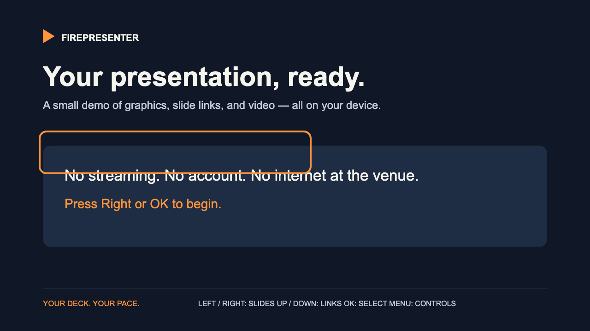

# FirePresenter

**An open-source Fire TV presentation platform for local slides, embedded graphics and videos, and clickable slide navigation.**

Bring a deck to the TV, then present with its remote. Slides hold until you advance. Everything needed for playback lives on the device, including the PowerPoint renderer. No account, subscription, CDN, or internet connection is needed to present.



## Launching without internet — read this first

**When presenting offline, launch FirePresenter through Settings / Apps:**

**Settings → Applications → Manage Installed Applications → FirePresenter → Launch application**

Fire TV's Amazon Home screen can display **“Home is Currently Unavailable”** without internet and hide the normal app-launching experience. Use the Settings route above to reach your installed app. This instruction also appears inside FirePresenter. If you press the remote's Home button during a presentation, use the same route to return.

Amazon documents this installed-app launch path in its [Fire TV installation instructions](https://developer.amazon.com/docs/fire-tv/installing-and-running-your-app.html). Menu names can vary by Fire OS version. On devices that support it, holding Home opens Quick Settings; choose Settings from there.

**Install and transfer your deck before arriving.** Restart your own Fire TV with its network disconnected, launch from Settings using only the remote, and play every clip during rehearsal. See [offline operation](docs/OFFLINE.md) for details.

## What it does

- Presents imported **PowerPoint `.pptx`** files with local graphics and embedded media.
- Follows **internal slide hyperlinks** on text, pictures, and shapes, using the remote or pointer input.
- Runs custom **bundled image decks** with SVG, PNG, JPEG, or WebP graphics, local MP4 videos, clickable hotspots, and optional automatic advancement after a clip.
- Receives a PowerPoint from a phone or computer over **local Wi-Fi**, then saves it for offline use. Internet is not required for that transfer.
- Includes an original six-slide demo and editable [PowerPoint examples](examples/).
- Keeps the display awake while the app is in the foreground and pauses media when it loses focus.

This is an early Android / Fire OS sideloading release. It is not an Amazon Appstore release or an Amazon product. The package is `org.firepresenter.app`.

## Install

Download the debug APK from [Releases](https://github.com/djfremen/FirePresenter/releases), or [build it](#build-from-source). Use an Android-based Fire TV running Fire OS, Android 7.0+ APIs, and a current WebView. This APK does not run on Vega OS devices.

1. Enable **ADB Debugging** under **Settings → My Fire TV → Developer Options**. If Developer Options is hidden, select the device name under **About** seven times.
2. Find the Fire TV's IP under **About → Network**. Connect your computer to the same local network.
3. Run the commands below and accept the debugging prompt on the TV.

```sh
adb connect YOUR_FIRE_TV_IP:5555
adb -s YOUR_FIRE_TV_IP:5555 install -r FirePresenter-v0.1.0-debug.apk
adb -s YOUR_FIRE_TV_IP:5555 shell am start -n org.firepresenter.app/.MainActivity
```

For normal remote-only use, launch through **Settings → Applications → Manage Installed Applications → FirePresenter → Launch application**, then choose **Try the demo** or **Last imported deck**. You can turn ADB Debugging off after installation. See [Amazon's ADB setup guide](https://developer.amazon.com/docs/fire-tv/connecting-adb-to-device.html) for device-specific setup.

## Remote controls

| Input | Action |
| --- | --- |
| Left / Right | Previous / next slide |
| Up / Down | Focus the slide's links; if there are none, show controls |
| OK / Enter | Follow the focused link; otherwise play/pause media, or advance a static slide |
| Play / Pause | Play or pause the current slide's first video/audio element |
| Menu | Show/hide presentation controls |
| Arrows while controls are open | Focus a control; OK activates it |
| Back | Hide controls, then return to the deck menu; Back there exits |
| Keyboard Home | Return to the first slide |
| Pointer click | Follow a slide link, toggle a video, or advance by clicking the slide background |

The **Fire TV remote's Home button belongs to Fire OS**. It leaves the app; it does not mean “first slide.” Controls stay open until you dismiss them or choose a navigation action.

## Bring your own deck

Choose **Receive a deck**. On a phone or computer on the same local Wi-Fi, open the address shown on the TV and upload a `.pptx` up to **64 MB**. The app retains the most recently imported deck; **Last imported deck** reopens it after restart. Return to the deck menu to close the receiver.

**Open a PowerPoint file** uses Android's file picker where available. Some Fire TV versions do not provide one; use Receive a deck instead.

Export Google Slides to Microsoft PowerPoint `.pptx` before importing. Embed media inside the file; web links, streaming players, and linked online videos are unavailable during offline playback.

For exact graphic layout and custom video return cards, create a bundled deck using the [local deck format](docs/DECK_FORMAT.md). Changing the bundled deck requires rebuilding the APK in this release. Runtime custom JSON/ZIP imports and a visual slide editor are not implemented.

## PowerPoint compatibility

The vendored [pptx-renderer](https://github.com/aiden0z/pptx-renderer) renders slides locally. PowerPoint support is approximate: animations, transitions, macros, and every Office effect are not supported. Font availability can change layout. Static slide images provide the most predictable appearance.

Use embedded **H.264 video / AAC audio in MP4** for the tested media path; other codecs depend on the device. Only the first media element on a PowerPoint slide is controlled by the remote. Imported slides advance manually after videos. Bundled decks can opt into returning to the next holding slide automatically. For smooth picture/audio fades, bake the fades into the source clip, as the included demo does.

See [validation and current limits](VALIDATION.md) for what was actually tested, including the remaining physical Fire TV checks for this release.

## Build from source

Install **JDK 17+**, Android SDK platform **35**, and Build Tools **35.0.0**. Create `local.properties` (ignored by Git):

```properties
sdk.dir=/your/path/to/Android/sdk
```

```sh
./gradlew assembleDebug lintDebug
```

The signed debug APK is `app/build/outputs/apk/debug/app-debug.apk`. No Node tooling is needed to build the app; its demo and renderer are checked in. Release signing is deliberately left to the distributor. Do not commit signing keys.

### Presenter tests

Install Node.js 22+:

```sh
npm ci
npx playwright install chromium
npm test
```

These tests block external network requests while exercising the bundled deck, remote navigation, internal PPTX links, embedded video, and 4:3 sizing. They save screenshots under `test-results/`. To use an installed browser, set `FIREPRESENTER_BROWSER_PATH` to its executable.

Regenerate the original demo with Python 3 and FFmpeg:

```sh
python3 scripts/create-demo.py
sh scripts/create-demo-video.sh
npm run fixtures
```

## Contributing and licensing

See [CONTRIBUTING.md](CONTRIBUTING.md) for the project layout and verification workflow. Bug reports are most useful with the Fire TV model, Fire OS and WebView versions, and a small presentation you are allowed to share.

Application code, documentation, and original demo assets: **MIT**. The earlier TV Deck Presenter prototype's copyright notice is retained. The unmodified renderer and its dependencies retain their own licenses, including Apache-2.0 and MPL-2.0; see [THIRD_PARTY_NOTICES.md](THIRD_PARTY_NOTICES.md). Imported presentation content belongs to its authors.
